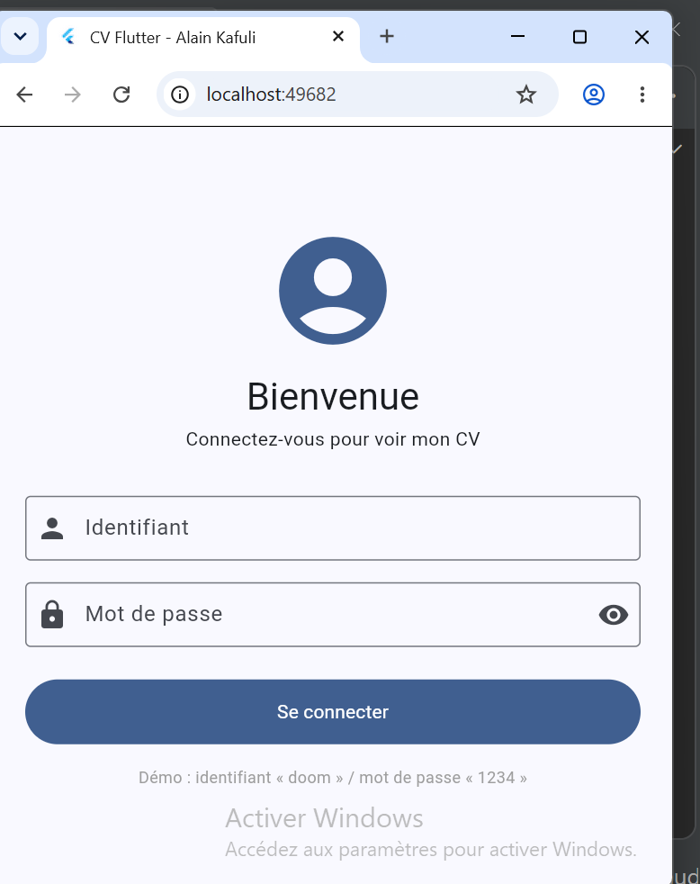
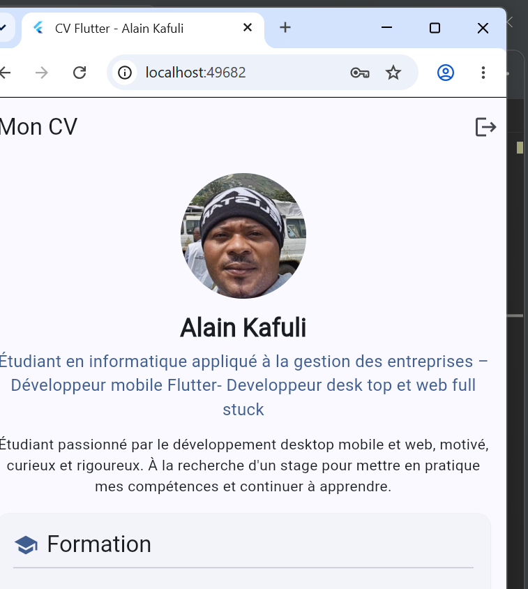
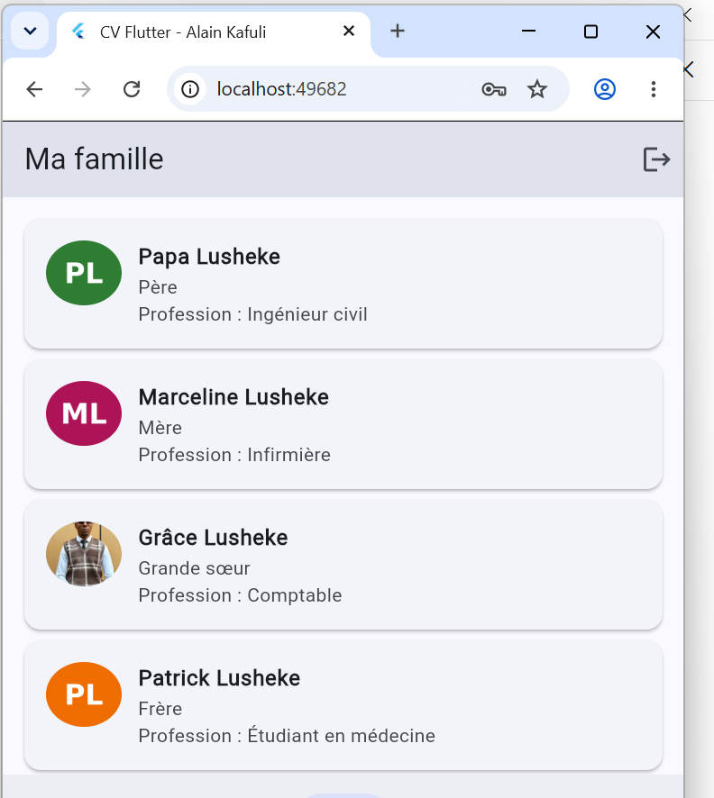
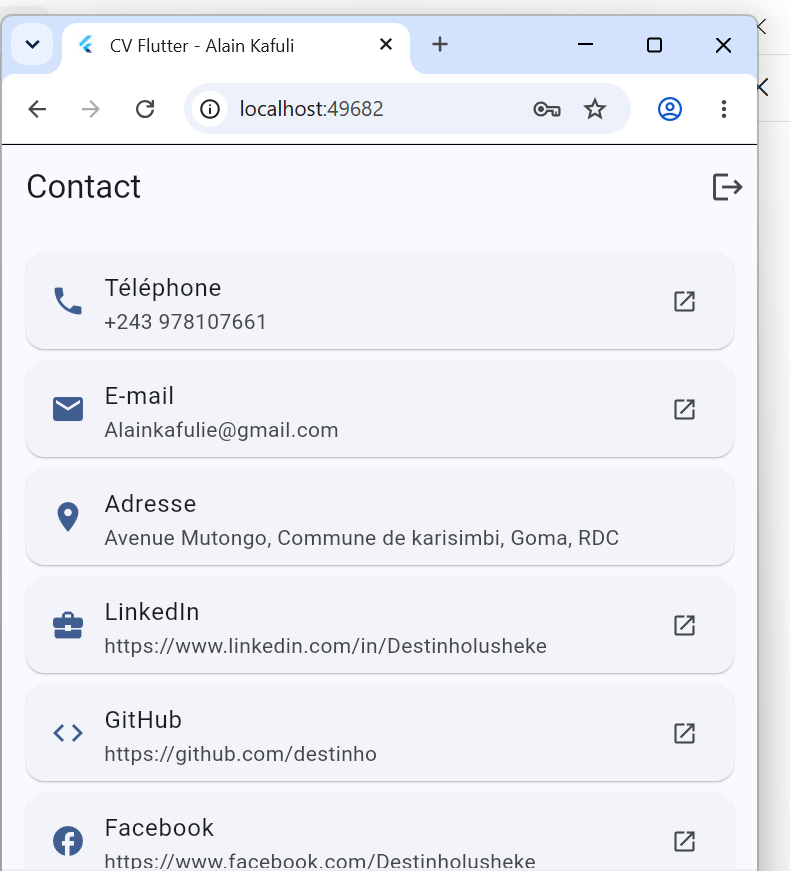

# cv_flutter_Alain

Application mobile Flutter présentant le **CV**, la **famille** et les **contacts** de IMANI KAFULI Alain(données fictives).
L'accès se fait par une page de connexion.

**Identifiants de démonstration :** `doom` / `1234`

## Fonctionnalités
- Page 1 : Connexion (identifiant, mot de passe masqué, bouton « Se connecter »)
- Page 2 : Accueil / CV (photo, nom, profil, formation, expériences, compétences, langues, centres d'intérêt)
- Page 3 : Famille (liste de `Card` avec photo, nom, lien de parenté, profession)
- Page 4 : Contact (téléphone, e-mail, adresse, LinkedIn, GitHub, Facebook — liens cliquables)
- Navigation par `NavigationBar` (barre du bas) et bouton de déconnexion

## Captures d'écran

| Connexion | Accueil (CV) |
|---|---|
|  |  |

| Famille | Contact |
|---|---|
|  |  |

## Lancer le projet
```bash
flutter pub get
flutter run
```

## Structure
```
lib/
├── main.dart
├── data.dart              # toutes les données fictives
├── widgets/avatar.dart
└── pages/
    ├── login_page.dart
    ├── main_shell.dart    # navigation
    ├── home_page.dart
    ├── family_page.dart
    └── contact_page.dart
```
